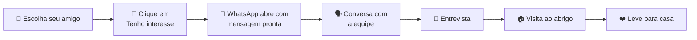

# 🐾 AdotaPet

### Uma nova chance para animais e famílias.

Plataforma web de **adoção responsável** que conecta cães, gatos e outros pets resgatados a pessoas prontas para mudar duas vidas.

 

[🌐 Ver o site](#) · [💬 Falar no WhatsApp](https://wa.me/5511947489497) · [🐞 Reportar um problema](../../issues)

## 💡 Sobre o projeto

A **AdotaPet** é uma rede independente de proteção animal que resgata, trata e prepara animais para encontrarem famílias responsáveis. Este site funciona como uma **vitrine digital**: o visitante conhece os animais disponíveis, lê a história de cada um e, se quiser adotar, fala diretamente com a equipe.

O projeto foi construído no **Bubble**, usando **no-code**, para ser simples, acolhedor e fácil de manter pela equipe do abrigo, sem depender de programadores.

> [!IMPORTANT]
> **A adoção não é feita diretamente pelo sistema.**
> Todos os botões de adoção levam o usuário ao **WhatsApp da AdotaPet**, onde a equipe conduz a conversa, a entrevista e o agendamento da visita ao abrigo.

---

## ✨ Funcionalidades

### 🐶 Para quem quer adotar

| Recurso | Descrição |
|---|---|
| 🔎 **Catálogo de animais** | Cards com foto, nome, idade, cidade, personalidade e status |
| 🎛️ **Busca e filtros** | Por nome, espécie, idade, sexo, porte e cidade |
| 🖼️ **Perfil completo** | Galeria de fotos com ampliação, história e cuidados de saúde |
| ❤️ **Favoritos** | Guarde os animais de que mais gostou |
| 🏷️ **Status do animal** | Disponível para adoção, Em tratamento ou Adotado |
| 🧭 **Como adotar** | Passo a passo do processo de adoção |
| 📖 **Histórias de adoção** | Exemplos de animais que ganharam um novo lar |
| 🤝 **Formas de ajudar** | Lar temporário, doações e voluntariado |
| 📍 **Contato** | Telefone, e-mail, endereço, horário e mapa |

### 🛠️ Para a equipe (área administrativa)

- 🔐 Acesso restrito pelo botão **"Trabalha aqui?"**
- ➕ Cadastro de novos animais com várias fotos de uma só vez
- ✏️ Edição de status e fotos
- 🗑️ Exclusão de animais
- 📊 Painel com o resumo: total, disponíveis, em tratamento e adotados

---

## 💬 Como funciona a adoção

1. **Escolha seu amigo**: navegue pelo catálogo e conheça os perfis.
2. **Clique em "Tenho interesse em adotar"**: o WhatsApp da AdotaPet abre com uma mensagem pronta, já com o nome do animal escolhido. Você revisa antes de enviar.
3. **Converse com a equipe**: tiramos dúvidas e entendemos o momento da sua família.
4. **Faça a entrevista**: uma conversa leve e responsável.
5. **Conheça o animal**: o encontro no abrigo é sempre agendado.
6. **Leve para casa**: começa uma nova história de afeto.

Os demais botões de ajuda (**lar temporário, doação, voluntariado e dúvidas gerais**) também abrem o WhatsApp, cada um com uma mensagem apropriada.

---

## 🧰 Tecnologias

| Ferramenta | Uso |
|---|---|
| [**Bubble**](https://bubble.io/) | Construção do site e da lógica, 100% no-code |
| [**WhatsApp (wa.me)**](https://faq.whatsapp.com/5913398998672934) | Canal único de adoção e atendimento |
| [**Google Maps**](https://www.google.com/maps) | Mapa com a localização do abrigo |

---

## 👥 Equipe

O projeto foi desenvolvido em equipe, com as responsabilidades divididas da seguinte forma:

| Integrante | Responsabilidades |
|---|---|
| **Leonardo** | Design (identidade visual e telas), automações e implementação dos animais na plataforma |
| **Thiago** | Workflows, design e programação básica |
| **Alexandre** | Workflows (em conjunto com o Thiago) |

---

## 📍 Contato

<table>
<tr>
<td>📱 <b>WhatsApp</b></td>
<td><a href="https://wa.me/5511947489497">+55 (11) 94748-9497</a></td>
</tr>
<tr>
<td>☎️ <b>Telefone</b></td>
<td>(11) 4002-8922</td>
</tr>
<tr>
<td>✉️ <b>E-mail</b></td>
<td><a href="mailto:adocao@adotapet.org.br">adocao@adotapet.org.br</a></td>
</tr>
<tr>
<td>📌 <b>Endereço</b></td>
<td>Avenida Vida Nova, 156 — Chácara Agrindus, Taboão da Serra/SP</td>
</tr>
<tr>
<td>🕘 <b>Horário</b></td>
<td>Segunda a sexta, 9h às 18h · Sábado, 9h às 13h</td>
</tr>
</table>

> Visitas ao abrigo são **sempre agendadas** pelo WhatsApp.

---

**Feito para criar encontros que importam.** 🧡

© AdotaPet Proteção Animal · Desde 2016 criando pontes entre animais e famílias

